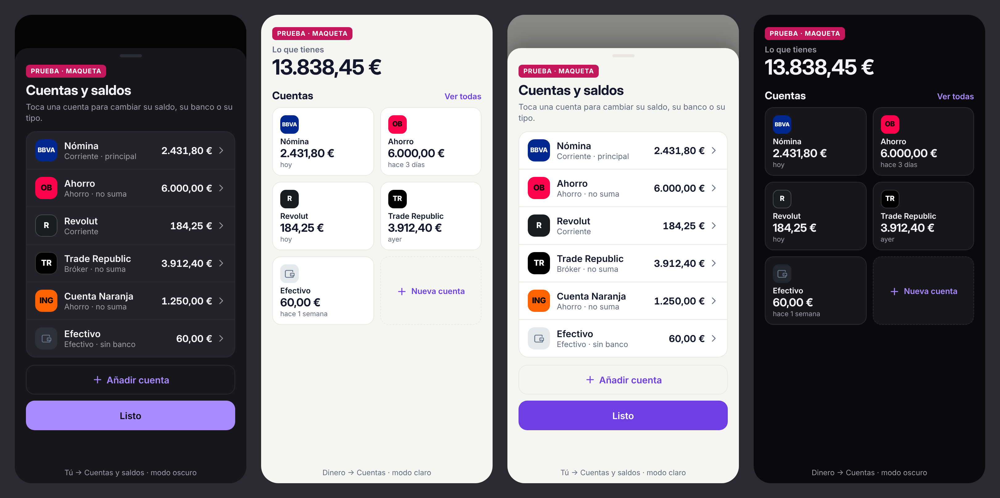
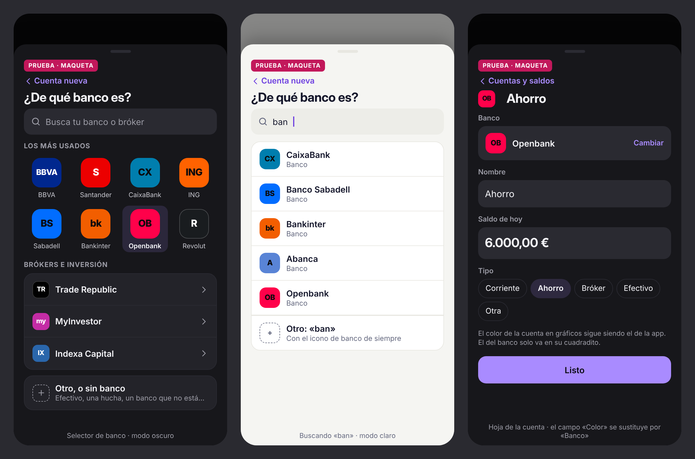

# Logos o colores de cada banco en las cuentas (24/10/2026)

*Producto y diseño. Propuesta: no hay nada programado. Petición del dueño: elegir el banco de una lista y que salga solo su logo o, al menos, su color.*

Hoy cada cuenta lleva un icono según su tipo (banco, hucha, cartera, gráfica) y un color de la app (`COLORES_CUENTA`). Ese icono no deja distinguir una cuenta de BBVA de una de ING.

## 1. Conclusión

1. **Sí se puede, y sin migración.** Al crear una cuenta se elige el banco de una lista con buscador y se guarda solo una clave (`banco: 'bbva'`) dentro de la cuenta, en `cfg().cuentas[]`. Si el banco no está en la lista, todo sigue como hoy.
2. **No hay un paquete abierto de logos que cubra los bancos españoles.** El más usado (Simple Icons, 3.467 marcas) solo trae 4 de los 21 bancos y brókers de la lista: CaixaBank, Revolut, N26 y Wise. No hay BBVA, Santander, ING, Sabadell ni ninguno de los brókers.
3. **Los servicios que dan logos por internet tienen pegas serias para nosotros.** Cada vez que se pinta un logo, ese servicio sabe qué banco usa cada persona y desde qué IP. Además no funcionan sin conexión, los resultados son desiguales y alguno exige poner su enlace en la web. En la prueba con el servicio de Google, 4 de 27 bancos salieron con un globo genérico (Kutxabank, Ibercaja, EVO, Cajamar) y varios a 16 o 32 píxeles.
4. **Recomendación: empezar por «color de marca + letras» (una ficha cuadrada con el color del banco y «BBVA», «S», «ING»…), con una lista propia de unos 40 bancos y brókers dentro de la app.** Se reconoce bien, funciona sin conexión, no avisa a nadie de qué banco usas, se ve igual de nítido en claro y en oscuro y casi no tiene riesgo de marca. Ver bocetos.
5. **Logos de verdad, solo como segundo paso y si el dueño acepta un riesgo pequeño de marca.** Serían dibujos guardados dentro de la app (nunca pedidos fuera), sacados de las salas de prensa de cada banco o de Simple Icons. La lista y la clave guardada son las mismas, así que se puede cambiar la ficha por el logo cuando se quiera.

*Boceto (datos inventados): Tú → Cuentas y saldos y Dinero → Cuentas, en modo oscuro y claro, con 375 px de ancho.*

*Boceto: selector «¿De qué banco es?» con los más usados y un buscador; resultado al escribir «ban»; hoja de la cuenta con el campo «Banco».*

## 2. Tablas

### 2.1 Fuentes de logos comparadas

| Fuente | Bancos de la lista (de 21) | Licencia y marca | Coste | Privacidad / sin conexión | Calidad |
|---|---|---|---|---|---|
| **Simple Icons** (paquete abierto) | 4: CaixaBank, Revolut, N26, Wise. Fuera de la lista: Deutsche Bank, bunq, PayPal, Coinbase, Binance… | Paquete CC0, pero cada logo sigue siendo marca de su dueño. El aviso del proyecto pide «buscar los permisos adecuados» | 0 € | Se guarda dentro de la app: no se avisa a nadie y funciona sin conexión | SVG de un solo color: queda muy limpio, pero solo sirve para estas 4 |
| **Repositorios de GitHub de logos de bancos** | 0 españoles. El mayor que encontramos es de bancos de Brasil (85) | Sin licencia: «los logos son propiedad de sus bancos» | 0 € | Igual que el anterior si se copian | Desigual |
| **Webs de logos** (companieslogo.com, logotyp.us, Wikimedia) | Casi todos | Webs de logos: «solo con fines editoriales e informativos». Wikimedia: cada logo con su propia licencia, muchos marcados como marca registrada | 0 € (companieslogo vende una API aparte) | Bien si se copian a mano | SVG o PNG, con fondos y tamaños distintos |
| **Brandfetch** (servicio) | Probablemente casi todos (no probado) | Gratis y sin pedir que se les cite. Obligan a cargar la imagen desde su servidor y prohíben guardarla | 0 € hasta 1.000.000 de imágenes al mes | **Mala**: cada vez que se ve una cuenta, Brandfetch recibe qué banco es y la IP. Sin conexión no sale | Buena: SVG, versión clara u oscura |
| **Logo.dev** (sustituto de Clearbit, que cerró) | Probablemente casi todos (no probado) | Gratis con 500.000 imágenes al mes, pero en uso comercial piden un enlace visible «Logos provided by Logo.dev» en una página pública. Se permite guardar copia | 0 €, o 33 $/mes sin enlace | Mala si se piden en directo; buena si se guardan antes | Buena |
| **Favicon de Google / DuckDuckGo** | Google: 23 de 27 probados; DuckDuckGo: 20 de 27 | Sin condiciones publicadas. El de Google no está documentado y puede cambiar | 0 € | Mala (igual que Brandfetch) | Mala: 5 de 27 de solo 16–32 px, fondos blancos o transparentes mezclados |
| **Hacerlo a mano** (catálogo propio) | Los que queramos (unos 40) | Color + letras: no copia ningún dibujo. Logos: los de cada banco, ver riesgos | Unas horas de trabajo | Perfecta: va dentro de la app | La que decidamos, igual para todos |

*Prueba propia del 24/10/2026: se pidieron los favicons de 27 bancos y brókers a Google (`s2/favicons`, 128 px) y a DuckDuckGo (`ip3`).*

### 2.2 Colores de marca aproximados (para la ficha)

Sacados del icono oficial de cada web (medido el 24/10/2026) o de Simple Icons. Son **aproximados**: antes de publicar hay que repasarlos a ojo con el logo delante. Las letras son propuesta nuestra.

| Banco o bróker | Color (hex) | Letras | De dónde sale |
|---|---|---|---|
| BBVA | `#00278E` | BBVA | icono web |
| Santander | `#EC0000` | S | icono web |
| CaixaBank | `#007EAE` | CX | Simple Icons |
| imagin | `#09F3CF` | im | icono web |
| ING | `#FF6200` | ING | icono web |
| Banco Sabadell | `#016DFF` | BS | icono web |
| Bankinter | `#F25E00` | bk | icono web |
| Unicaja | `#2BD124` | U | icono web |
| Abanca | `#5984D6` | A | icono web |
| Openbank | `#FF014A` | OB | icono web |
| Revolut | `#191C1F` | R | Simple Icons |
| N26 | `#48AC98` | N26 | Simple Icons |
| Wise | `#9FE870` | W | Simple Icons |
| MyInvestor | `#C42CA5` | my | icono web (acento) |
| Trade Republic | `#000000` | TR | icono web |
| Indexa Capital | `#2A66AB` | IX | icono web |
| eToro | `#6CFE89` | e | icono web (acento) |
| DEGIRO | `#009FDF` | DG | icono web |
| Interactive Brokers | `#D92027` | IB | icono web |
| Kutxabank, Ibercaja, EVO, Cajamar | sin dato | — | el icono no se pudo leer: hay que mirarlos a mano |

### 2.3 Las tres opciones, en corto

| | Color + letras (recomendada) | Logos guardados en la app | Logos pedidos a un servicio |
|---|---|---|---|
| Se reconoce el banco | Bien (color + letras conocidas) | Muy bien | Muy bien |
| Avisa a terceros de tu banco | No | No | **Sí** |
| Sin conexión | Sí | Sí | No |
| Riesgo de marca | Muy bajo | Bajo, no nulo | Lo asume en parte el servicio |
| Trabajo | Poco | Medio: buscar, limpiar y ajustar unos 40 dibujos | Poco, pero depende de un tercero |
| Claro / oscuro | Se controla al 100 % | Hay que revisar logos negros en oscuro | Según el servicio |

## 3. Recomendaciones

1. **Catálogo propio dentro de `app.js`** (`BANCOS`: clave, nombre, color, letras, tipo habitual, otros nombres para el buscador, como «La Caixa» → CaixaBank). Unos 40 bancos y brókers ocupan muy poco. *Porqué:* sin servidor, sin conexión y sin depender de nadie.
2. **Guardar solo `banco: 'bbva'` en la cuenta**, dentro de `cfg().cuentas[]`. *Porqué:* la configuración ya es un JSON, así que no hace falta migración. Una clave que la app no conozca (por ejemplo, de una versión más nueva) muestra el icono de siempre.
3. **Al crear una cuenta, el primer paso es «¿De qué banco es?»** (boceto): 8 bancos grandes arriba («Los más usados»), «Brókers e inversión» debajo, un buscador que también entiende nombres antiguos y «Otro, o sin banco» al final. Al elegirlo se rellenan el nombre y el tipo (con un bróker, «Bróker» y «no suma»). Todo se puede cambiar después. *Porqué:* es un toque, y el nombre ya no hay que escribirlo.
4. **En la hoja de la cuenta, «Banco» sustituye a «Color».** El color de la cuenta en gráficos, en la raya lateral y en los puntos sigue siendo el de la app (`COLORES_CUENTA`, que se asigna solo). El color del banco **solo** va dentro de su cuadradito. *Porqué:* el 22/10 se decidió que cada color de la app tenga un único significado. El verde de Unicaja o el rojo de Santander no pueden pintar una raya, porque se confundirían con ingresos y gastos. Dentro de una ficha con letras se leen como marca, no como aviso.
5. **La ficha sustituye al icono** donde hoy sale (`aj-ic` en Tú → Cuentas y `dm3-cta-ic` en Dinero), con el mismo tamaño y radio. Más adelante también en el chip de cuenta del formulario de gasto. Letras en blanco o negro según cuál contraste más (calculado). Los bancos casi negros llevan un borde fino en modo oscuro y los muy claros, en modo claro.
6. **Las cuentas que ya existen no cambian solas.** Como mucho, una sugerencia discreta («¿Es de Santander? Ponle su color»), si el nombre coincide con uno del catálogo. *Porqué:* no tocar datos sin que el usuario lo pida.
7. **Logos (fase 2, opcional):** si el dueño los quiere, guardarlos como SVG dentro de la app, uno por banco, sacados de Simple Icons (4) o de la sala de prensa de cada banco. Siempre dentro de la ficha, en blanco sobre el color de marca, con el mismo tamaño para todos. Nunca pedirlos a Brandfetch, Logo.dev ni Google en directo.

## 4. Riesgos

- **Marcas registradas.** Los nombres, colores y logos son de cada banco. La ley española permite usar una marca ajena para identificar o referirse a los productos de su dueño si se hace «conforme a prácticas leales» y sin aparentar relación con él. Indicar en qué banco tienes tu cuenta encaja ahí. Aun así, **no somos abogados**: copiar el logo es más delicado que poner un color y unas letras. Si un banco pide que lo quitemos, se quita su entrada y su cuenta vuelve al icono de siempre.
- **El repositorio es público.** Con logos copiados, los dibujos de las marcas quedarían publicados en GitHub. Con color + letras, no se publica ningún dibujo ajeno.
- **Colores que chocan.** Rojo (Santander, Openbank, IB), verde (Unicaja, Wise, eToro) y azul (BBVA) coinciden con colores con significado en la app. Por eso el color del banco va solo en la ficha (recomendación 4).
- **Letras poco reconocibles.** «IX» o «DG» dicen menos que un logo. Se mitiga porque el nombre del banco va siempre al lado.
- **Los bancos cambian de marca** (fusiones, logos nuevos). El catálogo hay que repasarlo de vez en cuando. Con color + letras es cambiar dos datos.
- **Si se usara un servicio externo:** se filtraría a un tercero qué bancos usa cada persona, la app no lo explicaría en ningún sitio y fallaría sin conexión (también en la futura APK).

## 5. Preguntas que debe decidir el dueño

1. **¿Color + letras ya, y logos quizá más adelante?** ¿O logos desde el principio, guardados en la app, aceptando el riesgo de marca? *Bloquea el siguiente paso.*
2. **¿Descartamos los servicios externos** (Brandfetch, Logo.dev, Google) por privacidad? Recomendamos que sí. *Bloquea.*
3. ¿El color del banco solo en su cuadradito (recomendado) o también en la raya y los gráficos, aunque choque con rojo, verde y azul?
4. ¿Quitamos el selector de «Color» de la cuenta cuando tiene banco, o lo dejamos dentro de «Más»?
5. ¿Qué bancos y brókers echas en falta en la lista? ¿Los usan Paloma, Alfredo u otros usuarios?
6. ¿Ofrecemos poner el banco a las cuentas ya creadas con una sugerencia, o solo a las nuevas?

## 6. Lo que no hemos podido averiguar o confirmar

- No hemos probado Brandfetch ni Logo.dev con bancos españoles (piden registrarse). Su cobertura es una suposición.
- Los colores son aproximados (medidos del icono de cada web). No los hemos comparado con los manuales de marca oficiales, y no sabemos el de Kutxabank, Ibercaja, EVO ni Cajamar.
- No hemos encontrado ningún repositorio abierto de logos de bancos españoles. Puede existir alguno pequeño.
- No hemos leído el texto oficial vigente del artículo 37 de la Ley de Marcas, solo resúmenes de despachos. No tenemos opinión de un abogado.
- No hemos mirado el manual de marca de cada banco para ver si prohíbe expresamente usos como este.
- No probado en un móvil real: los bocetos son HTML renderizado a 375 px.

## 7. Fuentes (consultadas el 24/10/2026)

- Simple Icons, datos de iconos (3.467 marcas, hex de marca): [simple-icons.json](https://raw.githubusercontent.com/simple-icons/simple-icons/develop/data/simple-icons.json) y [aviso de licencias y marcas](https://raw.githubusercontent.com/simple-icons/simple-icons/develop/DISCLAIMER.md)
- Repositorio de logos de bancos de Brasil: [Tgentil/Bancos-em-SVG](https://github.com/Tgentil/Bancos-em-SVG)
- Web de logos de empresas españolas y sus condiciones: [companieslogo.com/logos/spain](https://www.companieslogo.com/logos/spain/)
- Logo.dev, cierre de Clearbit: [logo.dev/clearbit](https://www.logo.dev/clearbit) · precios: [logo.dev/pricing](https://logo.dev/pricing) · enlace obligatorio: [attribution](https://www.logo.dev/docs/platform/attribution.md) *(fuente con interés propio: vende el servicio)*
- Brandfetch, condiciones y límites: [guidelines](https://docs.brandfetch.com/logo-api/guidelines.md), [overview](https://docs.brandfetch.com/logo-api/overview.md) *(fuente con interés propio)*
- Favicon de Google sin documentar: [logo.dev/docs/google-favicon-api](https://www.logo.dev/docs/google-favicon-api.md) *(escrito por un competidor: lo comprobamos con nuestra propia prueba)*
- Privacidad de los favicons de DuckDuckGo (2020): [next.ink](https://next.ink/brief-article/duckduckgo-et-vie-privee-un-probleme-de-favicon/)
- Uso referencial de una marca ajena en España: [Cuatrecasas, STS sobre límites al uso referencial](https://www.cuatrecasas.com/es/spain/propiedad-intelectual/art/sts-limites-al-uso-referencial-marca) · [Gómez-Acebo & Pombo, STS 485/2026](https://ga-p.com/publicaciones/el-uso-descriptivo-de-marcas-ajenas-como-limite-al-derecho-de-marca-sts-485-2026-de-30-de-marzo/)
- Prueba propia de favicons (Google y DuckDuckGo, 27 dominios) y colores medidos: 24/10/2026, no guardada en el repositorio porque contiene logos.

Para el PDF: poner los dos bocetos grandes en la primera página y la tabla 2.3 como semáforo (verde, ámbar, rojo) de las tres opciones.
