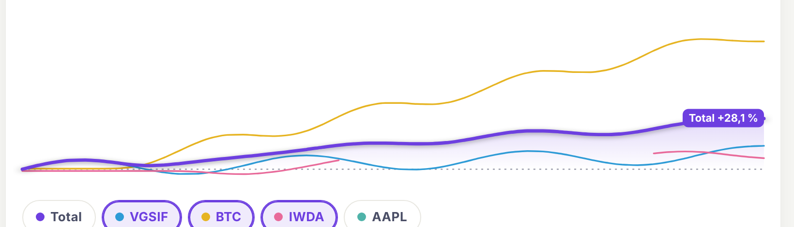
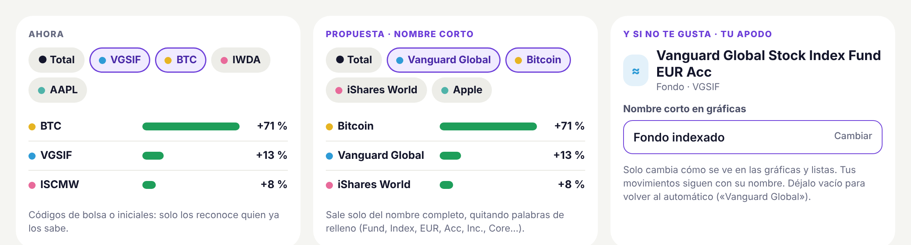
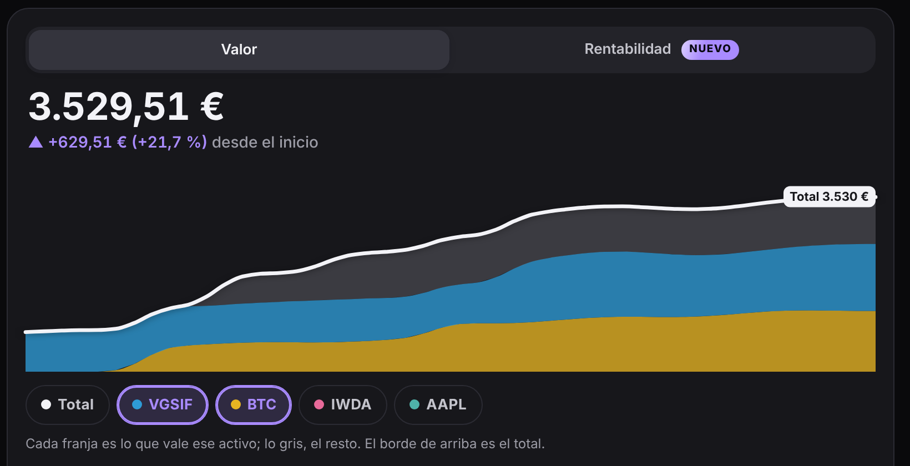
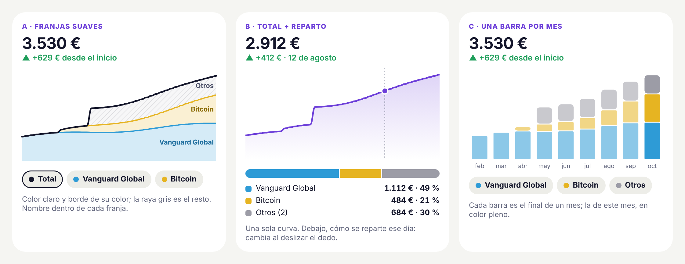
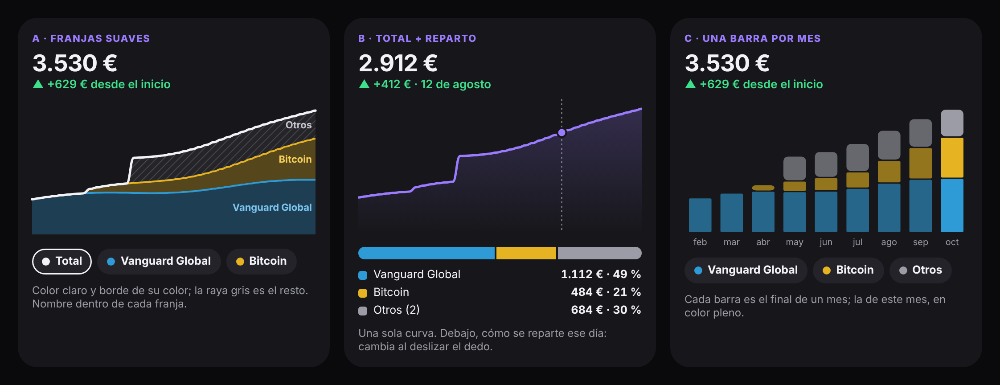
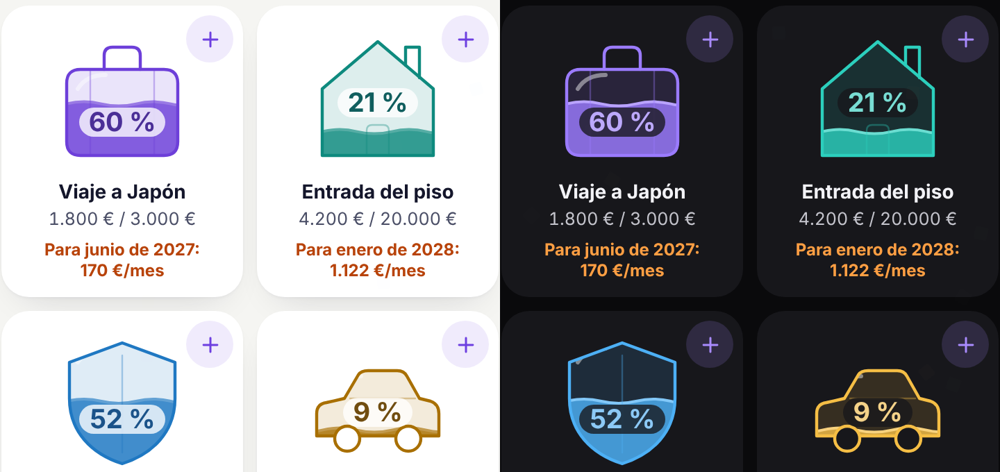
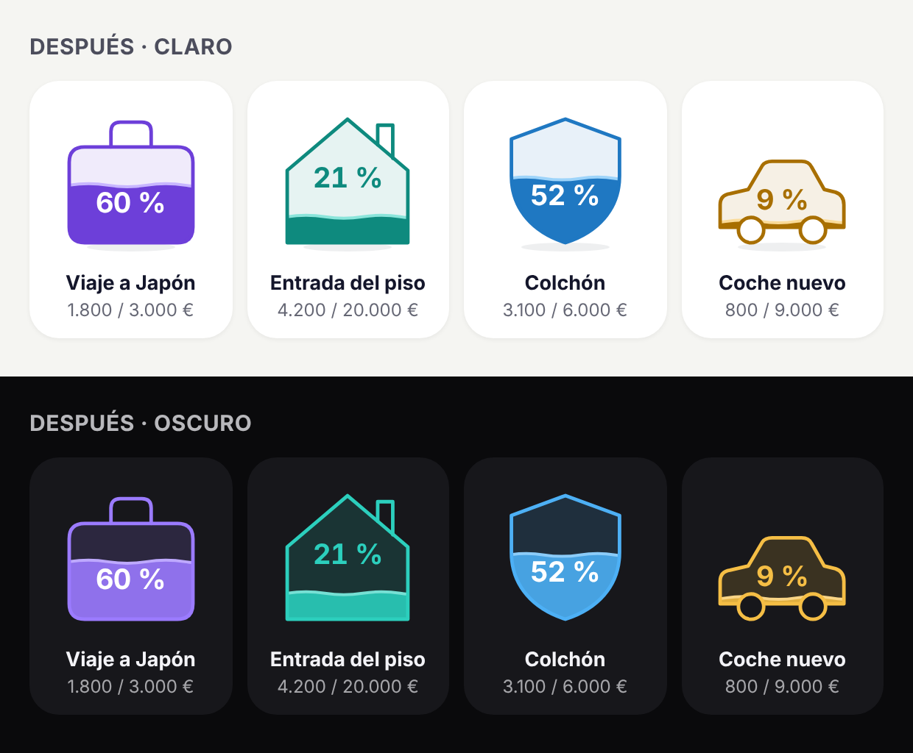

# 22 · Inversiones y formas de metas, segunda vuelta

Producto y Diseño · 29/10/2026 · responde al comentario del dueño sobre lo publicado el 28/10 (`docs/19`, apartados 3.1 y 3.3).

## 1. Conclusión

1. **El fallo de las líneas en PC es real y tiene una causa clara**: la línea de un activo que acabas de añadir sale **cortada a trozos**, y se queda así. Pasa por la animación de «dibujarse» en una gráfica estirada a lo ancho. Se arregla cambiando la animación (media hora de Desarrollo). En el móvil también pasa, pero apenas se nota: la línea acaba un poco antes.
2. **Nombres de los activos**: en vez de códigos (BTC, VGSIF, ISCMW), poner un **nombre corto sacado del nombre completo** («Bitcoin», «Vanguard Global», «iShares World», «Apple»). Además, en la hoja de cada activo, un campo opcional para **ponerle tu apodo**.
3. **Valor con varios activos**: recomiendo **A · franjas suaves**. Se queda la idea que te gusta (franjas apiladas), pero con colores claros, el borde de cada franja en su color, el nombre dentro de cada una y el resto con rayas grises. Si aun así no convence, la B (una sola curva y debajo una barra con el reparto) es la más fácil de leer.
4. **Formas de metas**: depurarlas sin cambiar la idea. Quitar el brillo y las rayas de dentro, el mismo grosor de trazo en todas, el mismo tamaño a la vista, líquido de un color más limpio y el % **sin pastilla y nunca encima de la línea del agua**.

## 2. El fallo de las líneas en PC

*Captura: Dinero → Inversiones → Rentabilidad, ventana de 1280 px, después de tocar «IWDA». La línea rosa se corta en mitad de la gráfica y no vuelve.*

| Qué se ve | Por qué pasa | Arreglo propuesto para Desarrollo |
|---|---|---|
| La línea del activo recién añadido sale a trozos | La animación de «dibujarse» usa `pathLength="1"` + `stroke-dasharray: 1`. Junto con `vector-effect="non-scaling-stroke"` y `preserveAspectRatio="none"`, Chrome mide el trazo en píxeles de pantalla: en PC la gráfica se estira ~4 veces a lo ancho, así que el «trazo entero» solo cubre una parte de la línea y el resto queda como hueco | Quitar `pathLength` y el `stroke-dasharray` de `.tr-linea-a.nueva`. Que aparezca con un fundido corto (opacidad de 0 a 1 en 0,3 s) o con el mismo recorte que ya usa `revelaSvg` |
| La gráfica queda muy plana (1.200 × 170 px) | La altura es fija (`.tr-chart { height: 170px }`) y el ancho crece con la pantalla | En pantallas anchas (`min-width: 760px`), altura de unos 240 px, o limitar el ancho de la tarjeta de inversiones |
| Las etiquetas del final («BTC +71 %») tapan el final de la línea | Se ponen pegadas al borde derecho, encima de la línea | Dejar un margen a la derecha de la gráfica (dibujar las líneas hasta el 85 % del ancho) y poner la etiqueta en ese hueco |
| Con 3 activos elegidos solo sale la etiqueta «Total» | Con más de 3 etiquetas se esconden todas menos la del total | Con el margen de arriba caben 4. Si chocan, se separan (ya lo hace) |

## 3. Nombres de los activos

| Opción | Se reconoce | Trabajo | Veredicto |
|---|---|---|---|
| Código de bolsa (BTC, VGSIF) o iniciales (ahora) | Solo si ya lo sabes | — | Fuera |
| **Nombre corto automático** (del nombre completo) | Sí, casi siempre | Bajo | **Recomendada** |
| Apodo que pone el usuario | Siempre | Bajo (va en la configuración, sin tocar Supabase) | **Recomendada como extra** |
| Leyenda aparte con el nombre completo | Sí, pero hay que mirar a dos sitios | Bajo | Descartada: ocupa sitio en el móvil |
| Solo color + inicial | No, con más de 2 activos | Bajo | Descartada |

**Cómo sacar el nombre corto (para Desarrollo, `invCorto`):**
- Del nombre completo se quitan palabras de relleno: *Inc., Corp., PLC, S.A., Fund, Index, Stock, Core, EUR, USD, Acc, Dist, UCITS, ETF, Class, FI*.
- Se quedan las palabras que queden hasta 16 letras. Si se pasa, primero se quitan los nombres de índice (*MSCI, FTSE, S&P*) y luego se corta a las 2 primeras palabras. Ejemplos: «Vanguard Global Stock Index Fund EUR Acc» → **Vanguard Global**; «iShares Core MSCI World» → **iShares World**; «Apple Inc.» → **Apple**; «Bitcoin» → **Bitcoin**.
- El código (VGSIF) solo se enseña en la hoja del activo, en gris, al lado del tipo.
- **Apodo**: en la hoja del activo, «Nombre corto en gráficas» (opcional). Se guarda en `cfg()` por `activoId`. **No** se cambia el nombre de los movimientos (eso sería un cambio masivo sobre datos reales). Vacío = vuelve al automático.
- «Qué tal va cada uno»: la columna del nombre pasa de 74 a unos 130 px. Si no cabe, se corta con «…».

## 4. Valor con varios activos: alternativas a las franjas

Antes (oscuro, PC): franjas de colores muy llenos, el amarillo se ve marrón y el gris de «otros» parece un hueco.

Tres alternativas, en claro y en oscuro:

| | A · Franjas suaves | B · Total + reparto | C · Una barra por mes |
|---|---|---|---|
| Qué es | Las mismas franjas, más claras, con borde de su color, nombre dentro y «otros» con rayas | Una curva del total; debajo, una barra con cuánto es cada activo ese día | Columnas apiladas, una por mes |
| Se entiende a la primera | Bien | Muy bien | Bien |
| Conserva la idea que te gustó | Sí | A medias | A medias |
| Al deslizar el dedo | Cifras de cada franja en la línea de abajo (ya existe) | La barra y las cifras cambian al día que tocas | Se marca el mes |
| Trabajo | Bajo (es retocar lo que hay) | Medio | Medio |

**Recomendación: A.** Detalles: relleno al 20 % en claro y 30 % en oscuro, borde de 2 px del color del activo, separación fina entre franjas, total en línea gruesa del color del texto, nombre de cada franja a la derecha y dentro de ella (si la franja es muy fina, el nombre se esconde y queda en el chip). Los chips usan el nombre corto del apartado 3.

## 5. Formas de las metas: depurado

Antes (captura real, claro y oscuro):

Después (boceto, mismas metas):

| Qué falla ahora | Propuesta |
|---|---|
| El brillo blanco solo cae dentro de algunas formas: en la maleta es una raya gris, en el escudo y el coche un punto suelto | Quitar el brillo (`fm-brillo`) |
| Rayas de dentro (maleta, escudo, puerta de la casa cortada por el agua) ensucian | Quitar los detalles (`F.d`) en el aspecto con color. Se mantienen asa, chimenea y ruedas, que son parte del contorno |
| La pastilla blanca del % tapa justo la línea del agua y se lee mal sobre el color | % sin pastilla, grande. Va en la parte más grande (la llena o la vacía) y como poco a 12 px de la línea del agua. Blanco sobre el líquido (sobre ámbar, casi negro); del color de la meta sobre la parte vacía |
| Las formas se ven de tamaños distintos (el coche, pequeño; la casa, grande) | Encajar cada forma en la misma caja (84 × 84) y apoyarlas todas en la misma base |
| Trazo de 2,2 px más detalles a 1,2 px: pesos mezclados | Un solo trazo de 2,4 px, puntas redondeadas, del color de la meta (tono oscuro en claro, tono claro en oscuro) |
| Líquido al 82 %: en oscuro se ve apagado; ola de 3 px | Líquido de color pleno (en oscuro, un pelín más oscuro que el borde); ola de 2 px con una línea de superficie más clara |
| La parte vacía casi no se distingue en claro | Parte vacía con un velo del color al 10 % (claro) y 16 % (oscuro) |
| — (toque juguetón) | Sombra suave en el suelo solo en modo claro; en oscuro no hace falta |

La meta conseguida no cambia: forma llena y el círculo con el visto.

## 6. Recomendaciones

- Arreglar primero el fallo de PC: es pequeño y se ve mal.
- Nombre corto automático y apodo a la vez: el primero arregla el 90 % de los casos sin que nadie haga nada.
- Franjas A en vez de las actuales, y dejar las de ahora en «Antes» unos días para comparar (como en otras pantallas).
- Formas depuradas sustituyen a las actuales; las de ahora también a «Antes».

## 7. Riesgos

- El nombre corto automático puede salir raro con nombres poco comunes. Para eso está el apodo.
- Con 5 o más activos, las franjas A se vuelven finas. Ya se limita a 4 elegidos más «otros».
- Las formas con el % fuera de la pastilla dependen del contraste del color: el ámbar necesita el texto oscuro (ya previsto).

## 8. Preguntas para el dueño

1. **Valor con varios activos: ¿A (franjas suaves), B (total + reparto) o C (barras por mes)?** Bloquea ese cambio, no los demás.
2. ¿Te vale el nombre corto automático, o prefieres que al crear un activo se te pregunte el nombre corto?
3. ¿Quieres poder ponerle apodo a cada activo? (Recomendado: sí.)
4. Formas: ¿te gusta el «después»? En concreto, ¿% dentro sin pastilla, o prefieres el % debajo de la forma, junto a las cifras?
5. ¿Sombra en el suelo de las formas (solo en claro) sí o no?

## 9. Lo que no hemos podido confirmar

- No he probado en un PC ni en un móvil reales: las capturas son del navegador de pruebas (Chromium) a 1280 px y 390 px. No sé si en Safari o Firefox el fallo de la línea se ve igual (probablemente parecido).
- No sé qué pantalla exacta vio el dueño. El fallo que he encontrado es el de la línea cortada al añadir un activo; si se refería a otra cosa (por ejemplo, las etiquetas tapando el final), está en la misma tabla.
- Los bocetos usan datos inventados; las cifras no son de nadie.

## 10. Fuentes

- Código de la app en `main` (29/10/2026): `evolucionHtml`, `invCorto`, `invLineasChipsHtml`, `invCadaUnoHtml`, `formaHtml`, `look.css` (`.tr-linea-a.nueva`, `.fm.cristal`).
- Capturas propias con el montaje de pruebas (29/10/2026).

Para el PDF: poner el «antes» y el «después» de las formas uno al lado del otro, y las tres alternativas de inversiones en una sola página con la A marcada.
