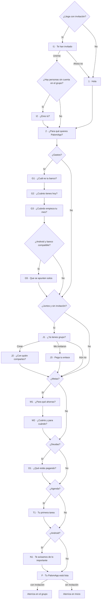

# 45 · Bienvenida nueva: tu PalomApp a tu gusto, paso a paso

*Producto y Diseño · 13/11/2026. Propuesta de estructura: **todavía no se programa**. Parte de la bienvenida por pasos de hoy (`docs/08` §13/11: Hola → ¿Qué quieres usar? → Avisos de PalomApp → Avisos del banco → Tu banco → Listo), de «Lo básico» y Descubre (`docs/38`) y de «Mis herramientas» (`docs/09` §13/11). Código leído sin tocar: `obPasos`, `bienvPasos`, `obHerrHtml`, `obNotifHtml`, `obAvBancoHtml`, `obBancoHtml`, `obListoHtml`, `obCargarInvitacion`, `maybeReclamar`, `doObFinish`, `HERRAMIENTAS`, `herrOn`, `herrPoner`, `DESCUBRE`, `AVISOS_DEF`, `BANCOS`, `PAQ_BANCOS`, `mesCfg`, `metaAbrirEditor`, `ppFilas`, `IW_TIPOS`, `marcaHtml`, `confeti`. Nada probado en un móvil.*

## 1. Conclusión

1. **Se pregunta «para qué», no «qué herramientas».** La segunda pantalla son 6 tarjetas grandes de objetivos («Controlar mis gastos», «Compartir gastos», «Ahorrar para algo»…). Cada una enciende sus herramientas y **abre su rama** de pantallas. Lo que no se elige queda apagado pero a la vista, con «lo enciendes cuando quieras».
2. **La rama manda.** Gastos → banco con logos, saldo y «Tu mes» (y en Android, avisos del banco solo si su banco es compatible). Juntos → «¿Ya tienes grupo o lo creamos?». Metas → primera meta con plantilla. Deudas → una deuda con plantilla. Agenda → primera tarea. Con invitación, el grupo va primero y la rama Juntos no sale.
3. **Corta siempre:** 3 pantallas como mínimo, 6–8 lo normal, **10 como máximo**. Si eligió más de lo que cabe, lo que sobra pasa a «Primeros pasos» en Inicio, que se rellena según lo que eligió y lo que saltó.
4. **Juego sin agobio:** la paloma vuela por la barra de arriba, un marcador «Tu PalomApp al 60 %», sellos pequeños al completar algo (6 en total, sin puntos ni rachas) y una **vista previa de su Inicio** que cambia en vivo con cifras inventadas. Confeti una sola vez, al final.
5. **Todo se puede saltar** en cada pantalla, y nada se pierde: lo saltado queda apuntado y se retoma desde «Primeros pasos». Solo hace falta una clave nueva en `cfg()` (`bienv`) y nada en Supabase.

---

## 2. El árbol de pantallas

**Reglas del árbol**

- **Orden fijo de ramas:** Gastos → Juntos → Metas → Deudas → Agenda → Avisos → Final. Así la barra de progreso no salta hacia atrás.
- **Tope de 10 pantallas** (sin contar la invitación). Si las ramas elegidas pasan de 10, se recortan **desde el final** (primero Agenda, luego Deudas, luego M2, que se fusiona con M1) y lo recortado pasa a «Primeros pasos». Se le dice en la pantalla 2: «Lo dejamos listo en unas 8 pantallas».
- **Invitación:** I1 primero. Si se une, «Compartir gastos» sale ya marcado y bloqueado («Ya estás en {grupo}»), sin rama J. Sin banco por defecto (como decidió el dueño en `docs/38`): «Controlar mis gastos» sale **sin marcar** para el invitado.
- **Avisos del banco (G5)** solo sale si: es la app de Android, eligió «Controlar mis gastos» y **alguno de los bancos de G1 está en `PAQ_BANCOS`**. Si no eligió banco, sale igualmente con el texto genérico. En la web nunca.
- **Avisos de PalomApp (N1)** solo en Android, al final, para que la lista de avisos sea la de lo que ha elegido.
- **Presupuestos, inversiones, fijos, tickets, informes, trayecto:** no tienen pantalla el primer día (no hay datos con los que trabajar). Se encienden con el objetivo y se proponen después (§6).

---

## 3. Cada pantalla

Todas: barra de la paloma arriba (§4.1), **«Saltar» arriba a la derecha** (salta solo esa pantalla), «Atrás» arriba a la izquierda, botón principal abajo y fijo (mínimo 48 px), una sola idea por pantalla, **sin scroll a 375 × 667**. Iconos de `ICONS` con `ic()`; sin emojis salvo el dibujo que el usuario elige para su meta o su deuda.

### 3.1 Tronco

| # | Título · línea | Qué se ve | Se elige → se guarda | Botón · Saltar |
|---|---|---|---|---|
| 1 | **¡Hola! Soy PalomApp** · «Te dejo la app a tu gusto en unos dos minutos.» | Paloma grande (`marcaHtml` 96 px) que entra volando y se posa; campo de nombre grande | Nombre → `nombre` (como hoy, `obGuardarHola`) | **«Empezar»** · «Saltar» = salta toda la bienvenida (pide confirmar: «Podrás hacerlo luego desde Primeros pasos») |
| 2 | **¿Para qué quieres PalomApp?** · «Elige todo lo que quieras. Lo cambias cuando quieras.» | Arriba, **vista previa de Inicio** (móvil pequeño, 140 px, §4.4). Debajo, 6 tarjetas en 2 columnas (72 px): icono en círculo de color, nombre y 1 frase. Al tocar: rebote, `check`, `sentir('tic')` y la vista previa cambia. Debajo: enlace «Afinar herramienta a herramienta» (abre la hoja de interruptores de «Mis herramientas») | Objetivos → `bienv.objetivos`; herramientas → `herramientas` vía `herrPoner` (solo lo apagado, §3.4) | **«Seguir (unas N pantallas)»** · «Saltar» = todo encendido como hoy |

Las 6 tarjetas de la pantalla 2 y lo que encienden:

| Tarjeta (icono) | Frase | Enciende | Abre la rama |
|---|---|---|---|
| Controlar mis gastos (`wallet`) | Cuánto te queda y en qué se te va | Presupuestos, Lectura de tickets, Informes, Avisos del banco | G |
| Compartir gastos (`users`) | Con tu pareja, tu casa o un viaje | Juntos, Calculadora de trayecto | J |
| Ahorrar para algo (`target`) | Un viaje, un colchón, la entrada de casa | Metas de ahorro | M |
| Pagar una deuda (`deuda`) | Un préstamo o la tarjeta, hasta el final | Deudas | D |
| Organizar mi día (`calendar`) | Tareas y planes con su día | Agenda y tareas | T |
| Ver mis inversiones (`chart`) | Lo que tienes invertido y cuánto ganas | Inversiones | — (a Primeros pasos) |

«Gastos e ingresos» no es tarjeta: es la base y siempre está (como en `HERRAMIENTAS`).

### 3.2 Ramas

| # | Título · línea | Qué se ve | Se elige → se guarda | Botón · Saltar |
|---|---|---|---|---|
| I1 | **Te han invitado a {grupo}** · «{Nombre} quiere compartir gastos contigo.» | Avatares de colores del grupo (`colorPersona`) y la paloma con un sobre | Unirse (como hoy, `obInviteHtml`) | **«Unirme»** · «Ahora no» (sigue en 1) |
| I2 | **¿Eres tú alguno de estos?** · «Así tus gastos de antes pasan a tu nombre.» | Fichas de las personas sin cuenta del grupo | Persona (lo que ya hace `maybeReclamar`) | **«Soy yo»** · «Ninguno» |
| G1 | **¿Cuál es tu banco?** · «Toca el tuyo. Puedes elegir varios.» | Rejilla de **logos** (los `top` de `BANCOS`, 3 columnas) + «Otro» y «Efectivo» (`cash`); buscador si toca «Ver más» | Bancos → `cuentas[]` con `banco` (sin saldo aún) | **«Seguir»** · «Saltar» |
| G2 | **¿Cuánto tienes hoy?** · «Copia el saldo de la app de tu banco.» | Una fila por banco elegido con su logo; cifra grande con el **teclado de la app** (`tecPulsar`); nota `shield` «No nos conectamos a tu banco» | Saldo → `cuentas[i].saldo` (con `numCampo`) | **«Seguir»** · «Saltar» (la cuenta queda sin saldo) |
| G3 | **¿Cuándo empieza tu mes?** · «Así “Te queda” cuadra con tu nómina.» | 2 tarjetas: `calendar` «El día 1» · `wallet` «Cuando cobro, el día…» (rueda de días 2–31). Debajo, mini calendario que pinta el mes elegido | → `mesInicio` (`{modo:'natural'}` o `{modo:'cobro', dia}`) | **«Seguir»** · «Saltar» (= día 1) |
| G5 | **Que se apunten solos** · «Funciona con {BBVA y Revolut}, tus bancos.» | Los logos de sus bancos compatibles; 2 filas «Qué ganas» y 2 «Tu privacidad» (las de hoy, `obAvBancoHtml`, recortadas); nota de «ajustes restringidos» solo al volver sin permiso | Permiso de lectura de avisos (como hoy, `avActivar`) | **«Activar»** · «Ahora no» |
| J1 | **¿Ya tienes grupo?** · «Para la casa, la pareja o un viaje.» | 3 tarjetas grandes: `plus` «Crear uno ahora» · `send` «Me han invitado» · `clock` «Más adelante» | Camino | La tarjeta es el botón · «Saltar» |
| J2 | **¿Con quién compartes?** · «Añádelos por su nombre: no hace falta que tengan la app.» | 4 plantillas: `heart` Pareja · `home` Casa · `plane` Viaje · `users` Amigos (pone nombre al grupo); 2–3 campos de nombre; al crear, el grupo «se monta» con avatares | → grupo nuevo + personas sin cuenta | **«Crear grupo»** · «Saltar». Tras crear, el mismo botón pasa a «Invitar por WhatsApp» y aparece «Seguir» |
| J3 | **Pega tu enlace** · «El que te pasaron por WhatsApp.» | Campo grande con «Pegar» | → `lsSet('unirse')` y se abre I1 | **«Abrir invitación»** · «Saltar» |
| M1 | **¿Para qué ahorras?** · «Elige una idea o escribe la tuya.» | 6 plantillas con su dibujo y cifra de ejemplo: Viaje (1.200 €), Colchón (3 meses de gastos), Entrada de casa, Coche, Regalo, «Otra cosa» | Plantilla → nombre y dibujo (el usuario lo puede cambiar) | **«Seguir»** · «Saltar» |
| M2 | **¿Cuánto y para cuándo?** · «Te decimos cuánto apartar al mes.» | Cifra grande (teclado de la app) + 4 chips de fecha (3, 6, 12 meses, «sin fecha»); debajo, en vivo: **«Unos 200 € al mes»** y un tarro que se llena | → meta en `ahorro[]` (lo de `metaAbrirEditor`: nombre, objetivo, fechaObjetivo, emoji) | **«Crear mi meta»** · «Saltar» |
| D1 | **¿Qué estás pagando?** · «Así verás cuánto te queda y cuándo acabas.» | 4 plantillas: `car` Préstamo del coche · `home` Hipoteca · `card` Tarjeta · `users` A una persona; 2 cifras: «Te queda» y «Pagas al mes»; en vivo: **«Acabas en marzo de 2028»** | → `deudas[]` (`nombre`, `previo`, `cuotaMes`, `emoji`) | **«Guardar deuda»** · «Saltar» |
| T1 | **Tu primera tarea** · «Lo que no quieres olvidar esta semana.» | Casilla rápida grande y 3 ideas en chips («Pagar el alquiler», «Pedir cita», «Comprar regalo»); chips de día: Hoy · Mañana · Este finde | → una tarea (los 10 campos de `tareas`, como `agRapidaCrear`) | **«Apuntar»** · «Saltar» |
| N1 | **Te avisamos de lo importante** · «Sin publicidad. Máximo 3 al día.» | `bell` grande; lista corta de avisos **según lo elegido** (la de `obNotifHtml`) | Permiso de avisos (`__nativo.notif.pedir`); `avisos` se queda con `AVISOS_DEF` | **«Permitir avisos»** · «Ahora no» |

### 3.3 Final

| # | Título · línea | Qué se ve | Se guarda | Botón · Saltar |
|---|---|---|---|---|
| F | **¡Lista, {nombre}!** · «Tu PalomApp al 80 %. Lo que falta, en Inicio.» | Paloma que aterriza sobre el 100 % (o se queda en su %), confeti una vez (`confeti`, sin él con «reducir movimiento»), los **sellos ganados** en fila, la **vista previa de Inicio a tamaño grande** con sus datos reales (banco, meta, grupo). Si queda algo: «Te falta: tu meta, invitar al grupo» | `bienv.hecho`, `nivel: 'basico'`, `altaApp`, etc. (lo de hoy en `doObFinish`) | **«Apuntar mi primer gasto»** (o **«Ir a {grupo}»** con invitación) · enlace «Ir a Inicio» |

### 3.4 Qué se apaga y qué no

- Lo que no elige en la pantalla 2 se **apaga** en «Mis herramientas» (solo esconde, nunca borra, como hoy).
- Pero **nada desaparece sin nombre**: en el final y en Descubre se ve «4 herramientas más esperando: Metas, Deudas…» con «Encender».
- Si salta la pantalla 2, todo queda **encendido** (sin clave, como hoy).

---

## 4. La parte de juego

### 4.1 La barra con la paloma

- Una línea fina arriba con **5 tramos con nombre**, no un número de pasos: **Tú · Tu dinero · Juntos · Tus planes · Listo**. Los tramos sin ramas elegidas no salen.
- La paloma (`marcaHtml`, 24 px) **vuela** del punto actual al siguiente al pasar de pantalla (300 ms, con un pequeño aleteo); con «reducir movimiento», salta sin animación.
- Debajo, en pequeño: **«Tu PalomApp al 40 %»** en vez de «Paso 2 de 8».

### 4.2 «Tu PalomApp al X %»

Se calcula con **las piezas que tocan según lo elegido**, no con todas. Cada pieza vale lo mismo:

| Pieza | Cuenta si eligió… | Hecha cuando… |
|---|---|---|
| Tu nombre | Siempre | `nombre` |
| Tu app a tu gusto | Siempre | Pasó la pantalla 2 |
| Tu banco | Gastos | Alguna cuenta con saldo (`conSaldo`) |
| Tu mes | Gastos | Existe `mesInicio` (también «día 1» elegido) |
| Tu grupo | Juntos | Está en algún grupo |
| Tu meta | Metas | Alguna meta |
| Tu deuda | Deudas | Alguna deuda |
| Tu agenda | Agenda | Alguna tarea |
| Tus avisos | Android | Permiso concedido |

Se deduce de los datos (como `descubierta()`), así que si la retoma luego, el % sube solo. El mismo % sale en «Primeros pasos» de Inicio hasta llegar al 100 %.

### 4.3 Sellos (6, pequeños)

Un sello redondo con icono que **cae y rebota** en la esquina al conseguirlo, con `sentir('ok')`, y se queda en la fila del final. Sin puntos, rachas ni avisos.

| Sello | Icono | Se gana al… |
|---|---|---|
| Con nombre propio | `persona` | Poner el nombre |
| Banco al día | `bank` | Poner un saldo |
| Mes a tu medida | `calendar` | Elegir «Tu mes» |
| En equipo | `users` | Crear o unirse a un grupo |
| Primera meta | `target` | Crear una meta |
| Piloto automático | `bolt` | Activar los avisos del banco |

No hay sello por deudas (no se celebra una deuda). Se guardan solos (se deducen de los datos); `bienv.sellos` solo apunta la fecha en que se enseñó, para no repetir la animación.

### 4.4 Vista previa en vivo de Inicio

- Un móvil dibujado pequeño (140 px de alto en la pantalla 2, grande en el final) con **piezas de Inicio en bloques**: tarjeta del mes, «Así vas», Juntos, una meta, «Estos días».
- Cada tarjeta marcada en la pantalla 2 **encaja su pieza** con un pequeño desliz, con **cifras inventadas** del ejemplo (§5). Desmarcarla la quita.
- En las ramas no se ve (no cabe sin scroll); vuelve en el final, ya con sus datos reales.
- Al terminar, las piezas de Inicio que se ponen (`inicioWidgets`) son las de la vista previa (`asivas`, `dias`, `juntos`, `meta`…), así lo que vio es lo que tiene.

### 4.5 Celebración final

Confeti una vez, paloma posándose, sellos en fila. Si no hizo nada (todo saltado), sin confeti: «Todo listo. Te esperamos en Inicio con tus primeros pasos.»

---

## 5. Cada herramienta en una frase y un ejemplo

Las frases son las de `HERRAMIENTAS`/`DESCUBRE` (para no tener dos textos). El ejemplo es el que sale en la vista previa y en Descubre. Cifras inventadas.

| Herramienta | Frase | Ejemplo (inventado) |
|---|---|---|
| Gastos e ingresos | Lo que entra y lo que sale. | «Cobras 1.400 €, llevas 620 € gastados: te quedan 780 €» |
| Presupuestos | Un tope al mes para cada cosa, y aviso si te pasas. | «Comida: 180 de 250 €. Vas bien» |
| Lectura de tickets | Haz una foto al ticket y la app apunta el total. | «Mercadona · 34,60 € apuntado en 3 segundos» |
| Avisos del banco | Se apuntan solos tus pagos y bizums, con «Deshacer». | «Bizum de 12 € a Laura, apuntado solo» |
| Juntos | Gastos compartidos con tu pareja, tu casa o un viaje. | «Casa: Ana te debe 23,40 €» |
| Metas de ahorro | Aparta para un viaje o un colchón y mira cuánto te falta. | «Viaje a Lisboa: 320 de 800 €, unos 80 € al mes» |
| Deudas | Un préstamo o la tarjeta: cuánto queda y cuándo acabas. | «Coche: quedan 4.200 €, acabas en marzo de 2028» |
| Agenda y tareas | Lo que tienes que hacer, con su día. | «Mañana: pagar el alquiler y llamar al taller» |
| Inversiones | Lo que tienes invertido y cuánto ganas. | «Fondo indexado: 2.000 €, ganas 140 €» |
| Informes | Un resumen de tu mes en frases sencillas. | «En octubre gastaste 90 € menos en restaurantes» |
| Calculadora de trayecto | Cuánto cuesta un viaje en coche, con el precio de hoy. | «Madrid–Valencia: 31 € de gasolina, 10 € por cabeza» |

Los nombres de personas y comercios son inventados y van solo en la vista previa (nunca se guardan).

---

## 6. Duración y lo que se deja para «Primeros pasos»

| Camino | Pantallas | Tiempo aprox. (estimado, sin medir) |
|---|---|---|
| Lo salta todo desde la 1 | 0 (confirmación) | 5 s |
| Hola + objetivos sin marcar nada + final | **3** | 30 s |
| Invitado: I1 + objetivos + final | **3** (4 con I2) | 40 s |
| Típico web: Hola, objetivos, G1, G2, G3, final | **6** | 1,5 min |
| Típico Android con Juntos: + G5, J1, J2, N1 | **9–10** | 2,5 min |
| Todo marcado | **10** (tope; lo demás, a Primeros pasos) | 3 min |

**Se deja para «Primeros pasos» (o para las sugerencias de `docs/38`)**, nunca en la bienvenida:

- Cobros y pagos fijos (la sugerencia «¿Qué se repite cada mes?» ya existe).
- Presupuestos (sin gastos el primer día no hay qué limitar; ya hay sugerencia a los 10 gastos).
- Primera inversión, informes, trayecto, importar extracto, «Inicio a tu gusto».
- Invitar a la gente al grupo, si creó el grupo pero no invitó.
- Lo que el tope de 10 recortó y **cada pantalla que saltó**.

«Primeros pasos» cambia: en vez de 3 filas fijas, **las 3 primeras pendientes** de esta lista, por orden: lo que saltó en la bienvenida → lo recortado → las filas de hoy (`ppFilas`). Con el % de §4.2 en la cabecera.

### Qué se guarda (solo `cfg()`, sin Supabase)

Una clave nueva de primer nivel, `bienv`:

| Campo | Ejemplo | Para qué |
|---|---|---|
| `objetivos` | `['gastos','juntos','metas']` | Ramas, «Primeros pasos», medir |
| `saltadas` | `['G2','M1']` | Retomar en «Primeros pasos» |
| `recortadas` | `['T1']` | Igual |
| `paso` | `'J2'` | Seguir donde lo dejó si cierra la app |
| `sellos` | `{ banco: '2026-11-14' }` | No repetir la animación |
| `hecho` | `'2026-11-14'` | Fin |

El resto ya existe: `nombre`, `herramientas`, `cuentas`, `mesInicio`, `ahorro`, `deudas`, `avisos`, `nivel`, `inicioWidgets`. Guardado pantalla a pantalla por `saveConfig`, como hoy. Repetida desde Tú: misma estructura, **solo añade** (no apaga herramientas, no toca cuentas con saldo).

---

## 7. Qué medir (sin datos personales)

Solo recuentos, en el panel de KPIs (`docs/37`, `kpis_resumen`), con cifras de 1 a 4 como «<5». Se leen de `cfg().bienv` sin mirar nada más.

| Qué | Cómo se cuenta | Buena señal (propuesta, sin datos) |
|---|---|---|
| % que termina | Altas con `bienv.hecho` ÷ altas | ≥ 70 % |
| Dónde se van | Altas sin `hecho` por último `paso` | Ninguna pantalla con > 15 % de abandono |
| Pantallas saltadas | Veces que sale cada código en `saltadas` | G2 y M2 son las que más se saltarán: vigilar |
| Objetivos elegidos | Cuántas altas marcan cada tarjeta | Para ordenar las tarjetas |
| % configurada el día 1 | Media del % de §4.2 al terminar | ≥ 60 % |
| Activación | % de altas que guardan algo los días 1–7 (C.1 de `docs/37`) | Mejor que las altas con la bienvenida de hoy |
| Retención 7 y 30 días | Ya existe en el panel | Comparar por semana de alta antes/después |
| Primeros pasos al 100 % | Altas con el % a 100 a los 7 días | ≥ 40 % |

Nada de nombres, correos, importes, bancos concretos ni textos escritos.

---

## 8. Alternativas descartadas

| Alternativa | Por qué no |
|---|---|
| La lista de 11 herramientas de hoy como pantalla 2 | Habla en «herramientas»; quien no sabe de finanzas no sabe qué es «Informes». Los objetivos traducen eso a lo que quiere hacer. La lista sigue en «Afinar» |
| Una pantalla de presentación por herramienta (carrusel) | Se salta sin leer; la vista previa enseña lo mismo mientras elige |
| Puntos, rachas o niveles | Agobia en una app de dinero y obliga a volver; 6 sellos que se ganan una vez bastan |
| Sin tope de pantallas | Con todo marcado serían 14 en Android; mejor 10 y el resto en «Primeros pasos» |
| Pedir los fijos y los presupuestos en la bienvenida | Alarga y el primer día no hay datos; ya hay sugerencias que lo piden en su momento |
| Avisos al principio | Sin saber qué ha elegido, la lista de avisos es genérica y se concede menos |

## 9. Riesgos

- **Más pantallas que hoy** en el camino largo (10 frente a 6): se compensa con el tope, «Saltar» en cada una y el % que se ve subir. Hay que medirlo (§7).
- **Apagar lo no elegido** puede esconder algo que luego busca: la lupa lo encuentra y Descubre lo nombra («4 esperando»). Ver decisión 1.
- **Vista previa y móviles pequeños:** la pantalla 2 (preview 140 px + 6 tarjetas) va justa a 375 × 667. Si no cabe, la vista previa baja a 96 px. Hay que pasar `tests/capturas/revisar.js`.
- **Avisos del banco:** el aviso de «ajustes restringidos» sigue haciendo falta mientras se instale desde archivo; solo aparece si al volver no hay permiso.
- **Dos guardados seguidos** de `bienv` pueden pisarse: copiar `cfg().bienv` y añadir, como en `docs/38` §4.
- **Usuarios de hoy:** no ven nada nuevo salvo que la repitan desde Tú, y entonces solo se añade.

## 10. Decisiones para el dueño

1. **(Bloquea la pantalla 2)** Lo que no elige, ¿se **apaga** o se queda **encendido**? **Recomendado: apagar**, porque cumple el objetivo 1 («a su gusto») y hace la app más sencilla; nada se borra y Descubre dice qué falta. Alternativa: todo encendido y los objetivos solo deciden las ramas.
2. **(Bloquea el árbol)** **Tope de 10 pantallas** y lo que sobra a «Primeros pasos». **Recomendado: sí.** Alternativa: sin tope pero con una pantalla de descanso («Ya está lo básico. ¿Seguimos con tu meta y tu grupo?»).
3. **(No bloquea)** ¿Sellos sí o no? **Recomendado: sí, los 6 de §4.3**, pequeños y sin avisos. Alternativa: solo el % y la celebración final.

## 11. Lo que no hemos podido averiguar o confirmar

- **Nada probado** en móvil ni en capturas: alturas y tiempos de §6 son estimaciones.
- El icono `trendUp` que usan Inversiones en `HERRAMIENTAS` y `DESCUBRE` **no aparece en `ICONS`** de `app.js` (se buscó el 13/11); aquí se propone `chart`. Que lo confirme Desarrollo.
- Si se puede crear un grupo con personas sin cuenta en un solo paso desde la bienvenida (J2) con las funciones de hoy, o hacen falta dos llamadas: lo mira Desarrollo con Datos y Seguridad.
- Si «pegar enlace» (J3) basta con `lsSet('unirse')` y repetir `obCargarInvitacion`: leído, no probado.
- Cuántos bancos de los usuarios reales están en `PAQ_BANCOS`: no se pueden mirar datos reales.
- Los umbrales de «buena señal» de §7 son propuesta, sin datos.

## 12. Fuentes

- Propias, consultadas el 13/11/2026: `docs/08-asistente.md` (§13/11), `docs/38-lo-basico-diseno.md`, `docs/09-tu-ajustes.md` (§13/11), `docs/37-primera-vez-iphone-kpis.md` §C, `supabase/migrations/2026-11-10_kpis.sql`, y `app.js` (funciones de la cabecera).
- Duolingo: preguntas de objetivo al principio, barra de progreso y mascota que guía. [Appcues GoodUX, «Duolingo's delightful user onboarding experience»](https://goodux.appcues.com/blog/duolingo-user-onboarding), consultado el 13/11/2026. *Interés propio: Appcues vende herramientas de onboarding.*
- [Appcues, «The 10 best user onboarding experiences»](https://www.appcues.com/blog/the-10-best-user-onboarding-experiences) y [CleverTap, «User onboarding best practices»](https://clevertap.com/blog/user-onboarding-best-practices/), consultados el 13/11/2026 (solo como referencia general; *los dos venden herramientas de onboarding*).

Para el PDF: 1) el árbol de §2 dibujado como metro de colores (una línea por rama, paradas = pantallas, la paloma en la primera); 2) tres móviles: pantalla 2 con la vista previa, G1 con la rejilla de logos y M2 con el tarro llenándose; 3) la barra con la paloma en tres momentos (20 %, 60 %, 100 %) y la fila de los 6 sellos; 4) una tira «3 · 6 · 10 pantallas» según el camino.
